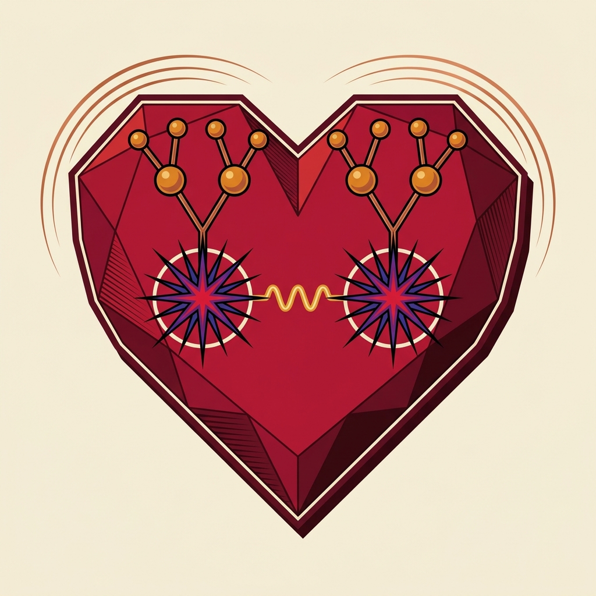

# SPS-HEART



HEART (Hadronic Excitations And Resonance Transitions) is an event generator for soft identified-hadron production
in p+p collisions at 158 GeV/c beam momentum (√s = 17.3 GeV). An inelastic event is the decay of two excited hadronic
systems, produced by Pomeron and pion exchange. Each system is either a catalogued resonance or a member of a resonant
continuum, and it decays by successive two-body hadronic transitions into the established hadrons of the PDG tables.
Fourteen parameters are fitted to the NA49 double-differential invariant cross sections of π±, K±, p, and p̄.

This repository holds the generator, the fit that produced the published model, the NA49 and SPS tables the fit
uses, and the result record of the fit. Everything needed to generate events at the published point, and to repeat
the fit, is here.

## Papers

- *HEART: a resonance-cascade model of soft hadron production in p+p collisions at 158 GeV/c.*
  [arXiv:2611.11570](https://arxiv.org/abs/2611.11570) [hep-ph].
- *The two-component picture of soft hadron production: Regge exchange, duality, and
  resonance cascades.* [arXiv:2611.14388](https://arxiv.org/abs/2611.14388) [hep-ph].

The first paper defines the model and its fit. The second gives the historical picture the model realizes.

## Quick start

```bash
git clone https://github.com/ondrejch/SPS-HEART.git && cd SPS-HEART
python -m pip install -e dev/mixing2006
python helpers/benchmarking/heart_events.py \
    --spec dev/mixing2006/config/runs/r146.json \
    --report dev/00runs/r146_regenerated_2026-11-06/report.json \
    --events 1000 --workers 4 --out heart_events.jsonl
```

The first call builds the decay kernel, which takes one to two minutes. Afterwards one core generates about six
events per second. The output is one JSON line per event with every final-state hadron's four-momentum
([event format](docs/event-format.md)).

### Without a clone

Each [release](https://github.com/ondrejch/SPS-HEART/releases) carries a wheel, `sps_heart-<version>-py3-none-any.whl`.
The wheel bundles the configuration, the run descriptions included. The release also carries the fit report
`r146_report.json`.

```bash
python -m pip install https://github.com/ondrejch/SPS-HEART/releases/download/v1.1.1/sps_heart-1.1.1-py3-none-any.whl
curl -LO https://github.com/ondrejch/SPS-HEART/releases/download/v1.1.1/r146_report.json
root=$(python -c "from na49_mixing._paths import nested_root; print(nested_root())")
python -m helpers.benchmarking.heart_events --spec "$root/config/runs/r146.json" --report r146_report.json \
    --events 1000 --workers 4 --out heart_events.jsonl
```

The wheel generates events. Repeating the fit needs a clone, because the fit reads the NA49 and SPS tables of the
repository.

### Container image

The image `ghcr.io/ondrejch/sps-heart` carries the generator, its configuration, and the fit report. It generates
events of the fitted model with nothing else installed:

```bash
docker pull ghcr.io/ondrejch/sps-heart:1.1.1
docker run --rm -v "$PWD":/work ghcr.io/ondrejch/sps-heart:1.1.1 --events 1000 --workers 4 --out /work/heart_events.jsonl
```

## Documentation

| Document | Contents |
|---|---|
| [docs/getting-started.md](docs/getting-started.md) | installation, tests, generating events, a first analysis |
| [docs/model.md](docs/model.md) | the model layer by layer, with the code module of each layer |
| [docs/event-format.md](docs/event-format.md) | the `heart-events/1` JSON Lines format, frames, units, conventions |
| [docs/inputs.md](docs/inputs.md) | the run description, kernel options, configuration files, data tables |
| [docs/fit.md](docs/fit.md) | repeating the fit, its outputs, and the result record |
| [docs/future-development.md](docs/future-development.md) | open directions for anyone who wants to extend the model |
| [docs/snapshot.md](docs/snapshot.md) | what this snapshot contains and what it leaves out |

## Layout

- `dev/mixing2006/`: the generator package `na49_mixing`, its configuration (`config/`, with the run descriptions of
  the project's fits under `config/runs/`; `r146.json` is the paper's), and its tests
- `dev/mixing2006/spshadrons.web.cern.ch/`: the NA49 and SPS data tables
- `helpers/benchmarking/`: the fit driver (`run_engine.py`), the event writer (`heart_events.py`), and their tests
- `helpers/na49_gateway/`: the client for running the fit on a cluster, with an example configuration
- `dev/00runs/`: the fit's report and the readout files the papers quote, and the result record
  `paper_record_r146/RECORD.json`

## License

GNU General Public License, version 2 or (at your option) any later version (SPDX: `GPL-2.0-or-later`). The
license text is in `LICENSE`.
